# Readability verification — 2026-10-29 UTC

Implementation SHA: f0fb4b79027c58292a2954af72ce1e09932fb8ca. No package version is declared.
Chromium 156.0.8078.4 headless, real WebGL/WASM rendering, viewport 1280×1000
and 390×844 with touch. Existing dark theme only. Screenshots crop the game.
CSS `filter: grayscale(1)` is a browser simulation, not a physical panel test.
All data is synthetic (empty game, default anonymous high score).

`production-*` views use the ordinary production build with normal random
selection. The other 28 images use a **separate test-only WASM fixture** which
selects a known current/next figure and pause state, using the unchanged game
renderer. The fixture is not included in the Pages artifact. Four cells and
existing shapes are retained; no production RNG, collision or input changes.

Runtime checks: menu/new game/pause/resume/game over, keyboard arrows/Space/P,
phone controls, live PL/EN and preserved paused board; no JS errors or horizontal
overflow at 320/390/1440px. Native g++ build passed with existing GL sysroot;
native GUI NOT verified: no DISPLAY/Xvfb, freeglut failed to open display.
No host packages were installed. Browser languages en-GB/pl-PL/fr-FR passed.

Rendered palette minimum contrast to all four board/preview backgrounds:

| Figure | Color | CSS grayscale |
| --- | ---: | ---: |
| Square / cyan | 14.05 | 10.72 |
| Line / red | 6.16 | 4.94 |
| L / yellow | 16.41 | 15.17 |
| Mirrored L / magenta | 7.21 | 5.71 |
| Z / green | 12.84 | 8.76 |
| Mirrored Z / blue | 3.83 | 3.23 |
| Nose / gray | 4.46 | 4.50 |

Pause is black text on white, 21:1. Red and magenta also needed lightening:
their original color contrast passed, but their actual grayscale render did not.
Other text uses of palette 6 retain readable black text on the lighter blue.
This is a bounded regression check, not a full WCAG certification.

## Production pause

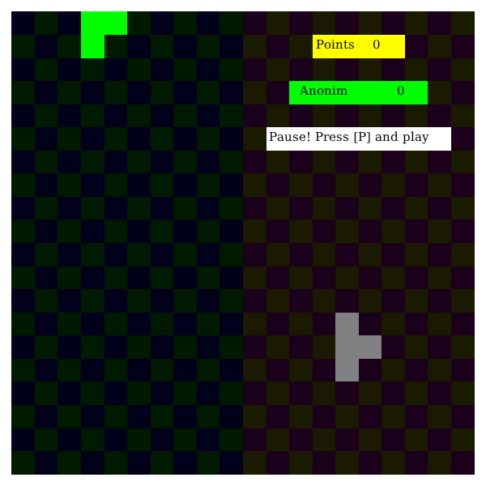

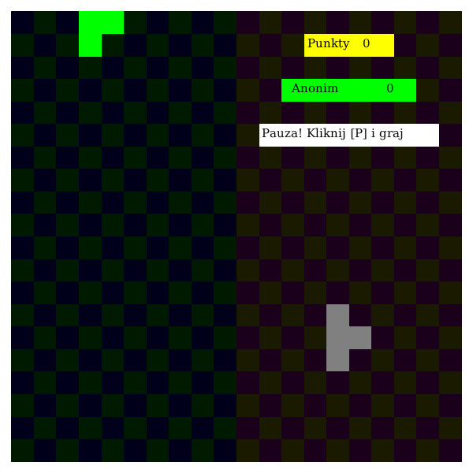

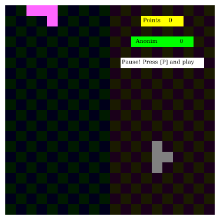

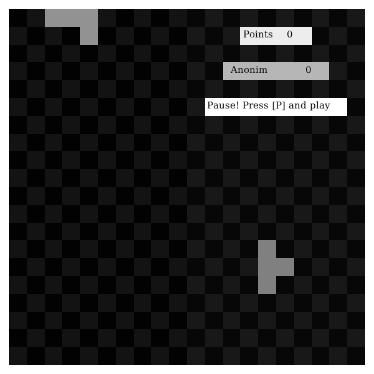

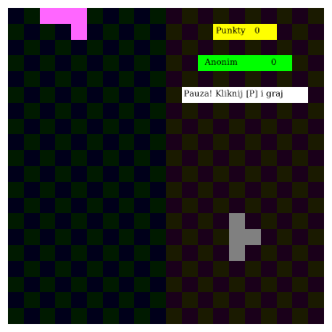

## All seven current / next shapes (test fixture)

### Figure 1

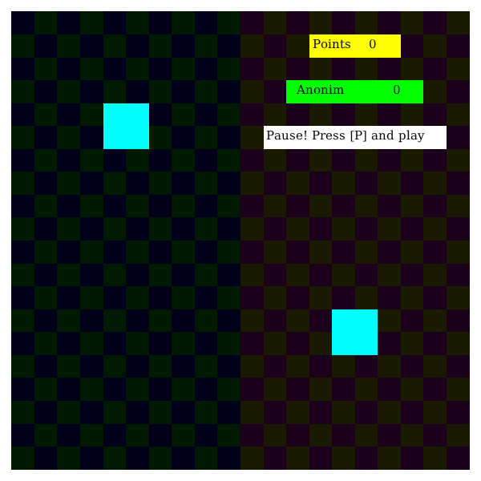

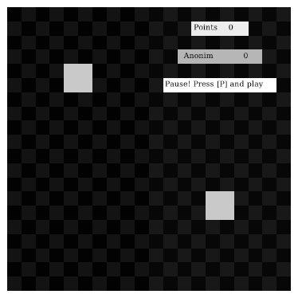

### Figure 2

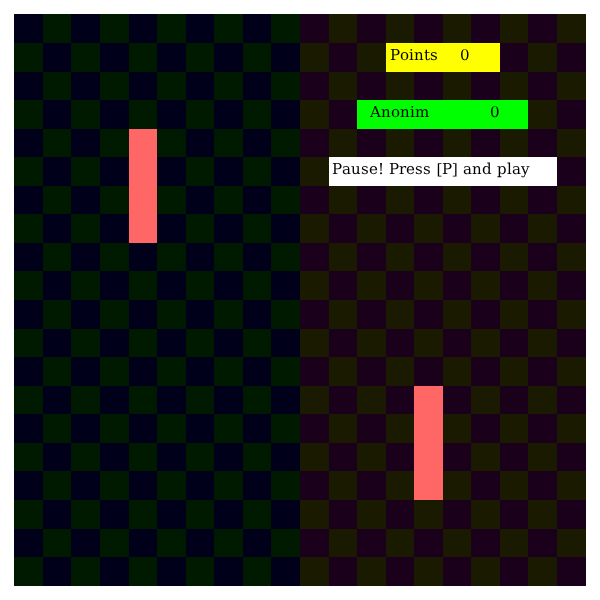

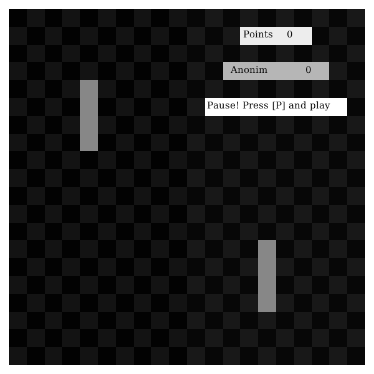

### Figure 3

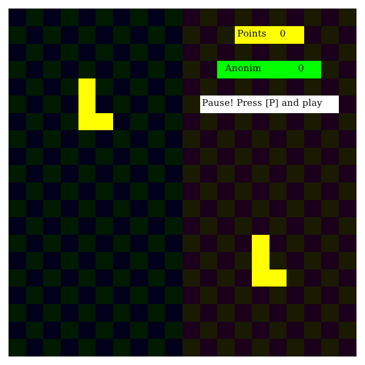

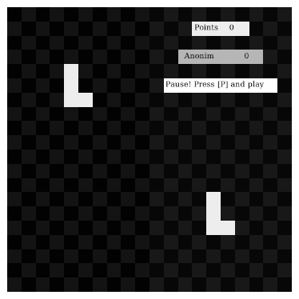

### Figure 4

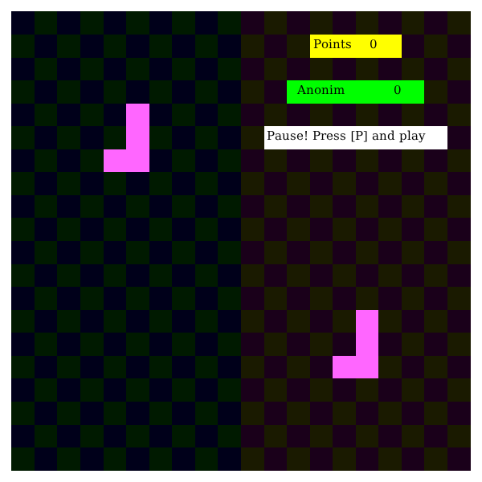

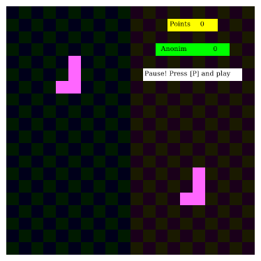

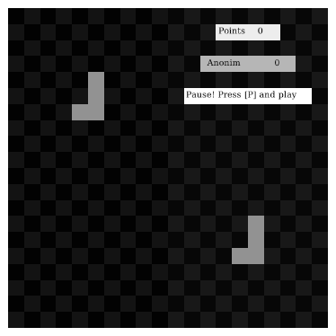

### Figure 5

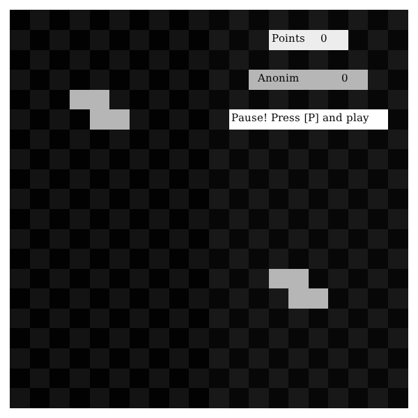

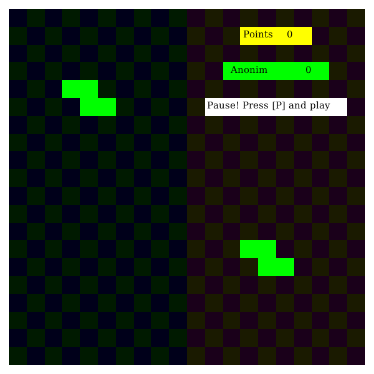

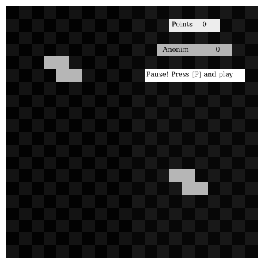

### Figure 6

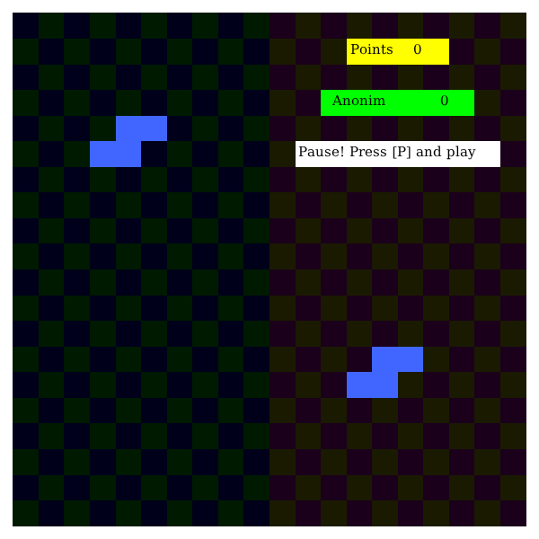

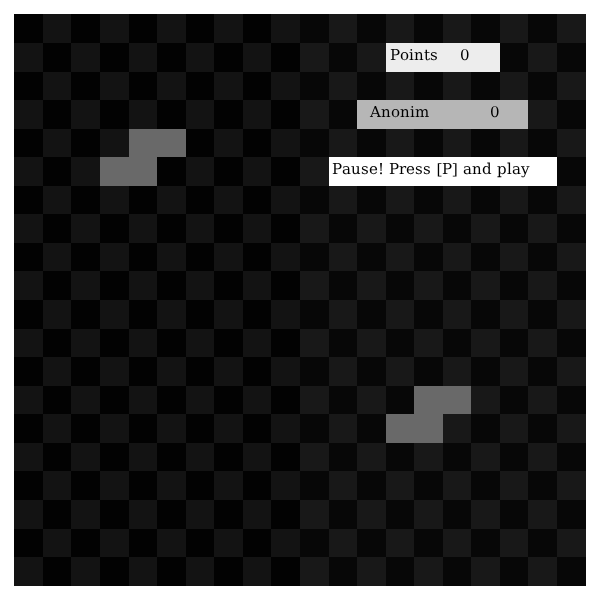

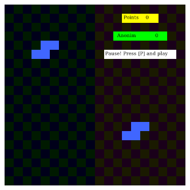

### Figure 7

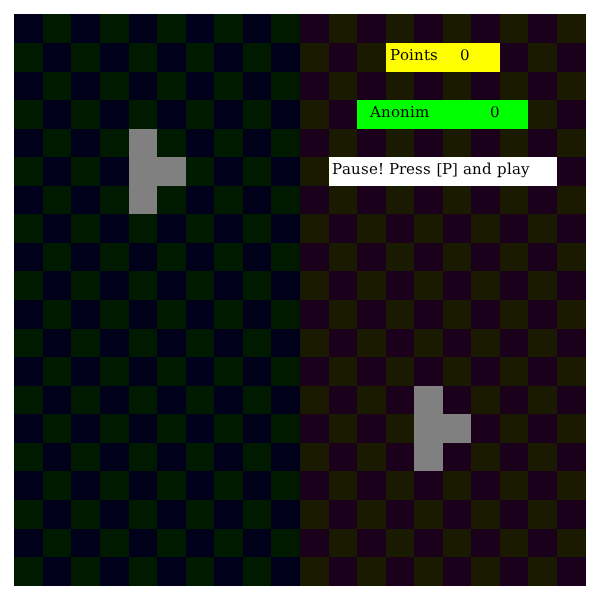

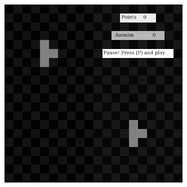

